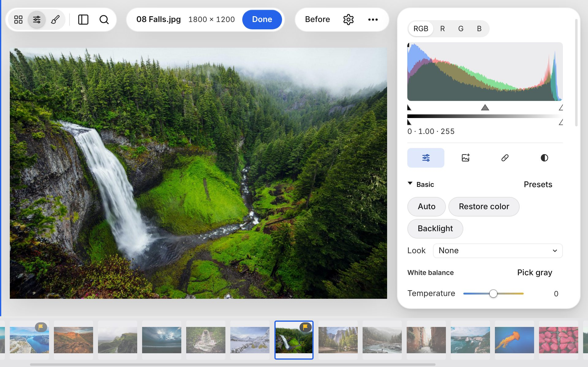
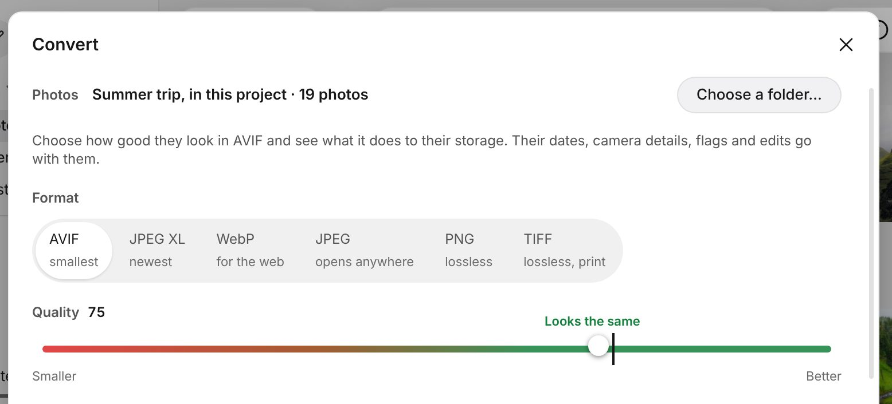

<p align="center">
  
</p>

<h1 align="center">jEditor</h1>

<p align="center">
  <b>The quick, simple editor for a folder of photos.</b><br>
  Open a folder, fix your photos one at a time or all at once, and convert them to save space.<br>
  All the essentials, and nothing in your way.
</p>

<p align="center">
  <a href="https://github.com/xmui/jEditor/releases/latest"></a>
  <a href="https://github.com/xmui/jEditor/actions/workflows/build.yml"></a>
  
</p>

<p align="center">
  <picture>
    <source media="(prefers-color-scheme: dark)" srcset="docs/images/grid-dark.jpg">
    
  </picture>
</p>

## Everything you need, nothing you don't

- **Open a folder and go.** Every photo shows up straight away. There's nothing to import and nothing uploaded, and your files stay where they are.
- **Quick fixes.** Rotate, crop and straighten. Fix the light and color with a few sliders or one-click Auto, or pick a look.
- **Fix a whole batch at once.** Rotate every selected photo in one go, crop them all like the last one, or copy one photo's adjustments onto as many as you like. Rename a whole folder in one step.
- **Sort as you go.** Flag the keepers, move them into folders, and delete with undo.
- **Undo anything.** Every step can be undone and redone, even a delete. Your originals stay safe until you save.

<table>
  <tr>
    <td width="33%" valign="top">
      <picture>
        <source media="(prefers-color-scheme: dark)" srcset="docs/images/viewer-dark.jpg">
        
      </picture>
      <p><b>Photos.</b> Look, flag, rotate, crop and sort.</p>
    </td>
    <td width="33%" valign="top">
      <picture>
        <source media="(prefers-color-scheme: dark)" srcset="docs/images/adjust-dark.jpg">
        
      </picture>
      <p><b>Adjust.</b> Light, color and looks, on one photo or many.</p>
    </td>
    <td width="33%" valign="top">
      <picture>
        <source media="(prefers-color-scheme: dark)" srcset="docs/images/paint-dark.jpg">
        
      </picture>
      <p><b>Paint.</b> Text, shapes and brushes, on layers.</p>
    </td>
  </tr>
</table>

## Convert to save space

<p align="center">
  <picture>
    <source media="(prefers-color-scheme: dark)" srcset="docs/images/convert-dark.jpg">
    
  </picture>
</p>

- **A whole folder at once,** to AVIF, JPEG XL, WebP, JPEG, PNG or TIFF. iPhone HEIC photos too, so any app can open them.
- **See before you commit.** The quality slider marks where a photo still looks the same, a close-up shows the original beside the result, and you see how much space you'll free.
- **Nothing lost.** Dates, camera details, flags and edits go with each photo. Keep both, or replace the originals and get them back with one undo.

## Great with scans and old photos

- **Scan straight into the folder,** and each scan shows up as it lands. (The Windows app.)
- **Bring old prints back.** Take the fade off with Restore color, find dust and scratches for you, and remove the dots from a magazine scan.
- **Dates in batches.** Give a scanned order one date, shift dates when a camera's clock was wrong, or number them in scan order.

## Every feature

<details>
<summary><b>The full list</b>, by what you're doing</summary>

**Looking and sorting**
- Grid and single view, a film strip, zoom, full screen and a slideshow
- Flags: pick, reject, needs rescan, and five color labels, with a count of each in the sidebar
- Search and Find anything (`Ctrl+K`): photos, folders, projects and commands
- Rename one, rename many with a pattern (`Smith_001`, `Smith_002`…), or find and replace in names
- Move and copy into folders, make new folders, delete to the bin
- Find duplicates (still being finished)
- Info: size, camera details and the place it was taken; edit the title, caption, keywords, rating, date, author and copyright, or every EXIF, IPTC and XMP field
- Undo and redo for every step, with a history to jump back through
- The folder is watched, so new and changed photos show up on their own

**Rotating and cropping**
- Rotate and flip, one photo or a whole selection
- Turn upright: finds sideways photos and turns them the right way up
- Crop and straighten, with aspect presets (4×6, 5×7, 8×10, square and more), a level line and a loupe
- Auto crop finds a print on a scan, straightens it and crops it (an experiment, in Settings)
- Crop a whole selection like the last crop

**Batch edits**
- Rotate, turn upright, flag, move, rename, export or convert a whole selection
- Copy and paste adjustments onto many photos, or Sync from one
- Restore color on a selection, or on a whole roll at once
- Dates for scans: set one date for all, shift by an amount, or number them in grid order
- Write edits into the files, or export, for every unsaved photo at once

**Adjust**
- Quick fixes: Auto, Auto color, Restore color and Backlight
- Histogram and levels, exposure, contrast, highlights, shadows, whites and blacks
- White balance with a gray picker, vibrance and saturation
- Texture, Clarity and Dehaze
- Tone curve, color mixer and color grading
- Looks: film stocks and creative looks you can dial in and save as your own
- Masks: linear, radial and brush, plus the sky and the subject found for you
- Sharpening, noise reduction, vignette and grain
- Perspective and lens fixes
- Before and after, presets, and RAW and HEIC photos

**Old photos**
- Restore color for faded prints and slides
- Find dust, spot removal with heal or clone, and red-eye
- Scratches and creases: drag along one, or find them for you
- Descreen takes the printed dots off a magazine or newspaper scan

**Paint**
- Layers with opacity and blend modes, masks, groups, clipping and adjustment layers
- Brushes: soft and hard round, pencil, ink, marker, airbrush, spray, charcoal, watercolor, texture, mixer, retro brushes and your own
- Eraser, spot heal, heal, clone stamp, dodge, burn, sponge, blur, sharpen and smudge
- Selections: rectangle, ellipse, lasso and magic wand, with grow, shrink and feather
- Shapes, lines and arrows, fill, gradient and recolor
- Text in any of your computer's fonts; text and shapes stay editable
- Free transform, distort, perspective and Warp, with ready-made warp styles
- Filters: blur, sharpen, noise and more; symmetry, QuickShape, pen pressure
- A new blank canvas, canvas size and crop

**Convert and export**
- Convert to AVIF, JPEG XL, WebP, JPEG, PNG or TIFF, with the quality that looks the same marked and the space saved shown
- Export copies for the web, for print or as you set them: size, format, quality, naming and metadata, with presets
- Export or copy a project onto a USB drive or card, or burn it to a disc (Windows)

**Folders, drives and projects**
- A sidebar with your projects, pinned folders, drives and cards
- Several windows side by side, and moving photos between them (the desktop apps)
- Big folders and network drives
- Import from a camera's card
- The Photos library in the sidebar (Mac)

**Scanning**
- Scan straight into the folder, find the prints on the glass, and tethered camera capture (Windows)

**Make it yours**
- Light and dark, accent color, glass strength, toolbar layout and your own keyboard shortcuts
- A menu bar with every command and its key
- A home page, a short tour and a guide (`F1`)

Every tool and key is in [Using jEditor](docs/using-jeditor.md).
</details>

## Get it

| | |
|---|---|
| **Windows** | [**Download the installer**](https://github.com/xmui/jEditor/releases/latest) `jEditor-Setup-x.y.z.exe`. No admin needed. Or the portable zip. |
| **Mac** | [**Download the .dmg**](https://github.com/xmui/jEditor/releases/latest). Apple silicon and Intel, macOS 12 or later. Or with Homebrew: `brew tap xmui/jeditor https://github.com/xmui/jEditor && brew install --cask jeditor` |
| **Linux** | [**AppImage**](https://github.com/xmui/jEditor/releases/latest) for any distribution (updates itself), `.deb` for Ubuntu, Debian and Mint, `.pacman` for Arch |
| **Web** | [**xmui.github.io/jEditor**](https://xmui.github.io/jEditor/) in Chrome or Edge. Nothing to install. |

A lighter Mac build on Tauri (`jEditor-x.y.z-mac-tauri.dmg`) is in the [betas](https://github.com/xmui/jEditor/releases) for now.

<details>
<summary>"Windows protected your PC" or "jEditor can't be opened"?</summary>

jEditor isn't code-signed yet, so the first launch needs one extra click:

- **Windows:** click **More info**, then **Run anyway**.
- **Mac:** open **System Settings → Privacy & Security** and click **Open Anyway** next to jEditor.

It only asks once. More in [Installing](docs/installing.md).
</details>

## Quick start

1. **Open a folder**, or drop one onto the window.
2. **Look and sort.** `S` shows one photo, `G` the grid, `←` `→` move between them. `P` flags a keeper, `[` `]` rotate, `C` crops.
3. **Fix one, then the rest.** `E` opens Adjust, and `Ctrl+Shift+C` copies what you did. In the grid, select the others and `Ctrl+Shift+V` pastes it onto them all.
4. **Convert** from the home page or the ⋯ menu.

`Ctrl+K` (`⌘K` on a Mac) finds any command, photo or folder. Press `F1` in the app for the guide, or read [Using jEditor](docs/using-jeditor.md).

## Platforms

The Windows, Mac and Linux apps have everything and keep up with each other. The web version is lighter: it has no sidebar of your drives and no extra windows, and scanning is in the Windows app only. The full list is in [Platforms](docs/platforms.md).

## Learn more

- [Using jEditor](docs/using-jeditor.md): every tool and key
- [Installing](docs/installing.md): where things go, updating, removing
- [Platforms](docs/platforms.md): what runs where, and why
- [Roadmap](PLAN.md): what's next

## Build and test

```sh
npm ci && npm test         # the tests, in headless Chrome
npm start                  # the web version at http://localhost:3000
cd mac && npm ci && cd .. && npm run mac   # the Mac and Linux app
```

Windows builds with `./scripts/build.ps1`. [Developing](docs/developing.md) has the rest: building each app, releases and betas. `node scripts/readme-shots.js` takes this page's screenshots again.

<sub>Photos in the screenshots: [Unsplash](https://unsplash.com), via [Lorem Picsum](https://picsum.photos).</sub>
