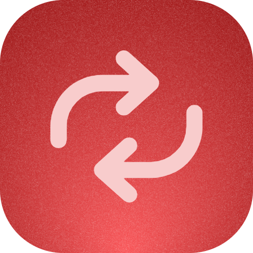
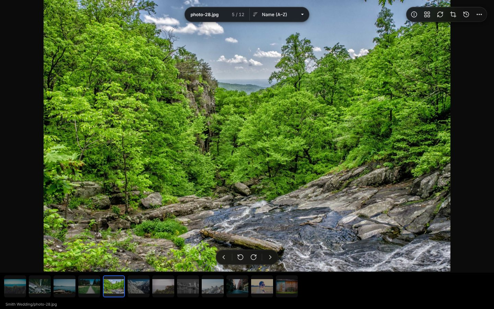
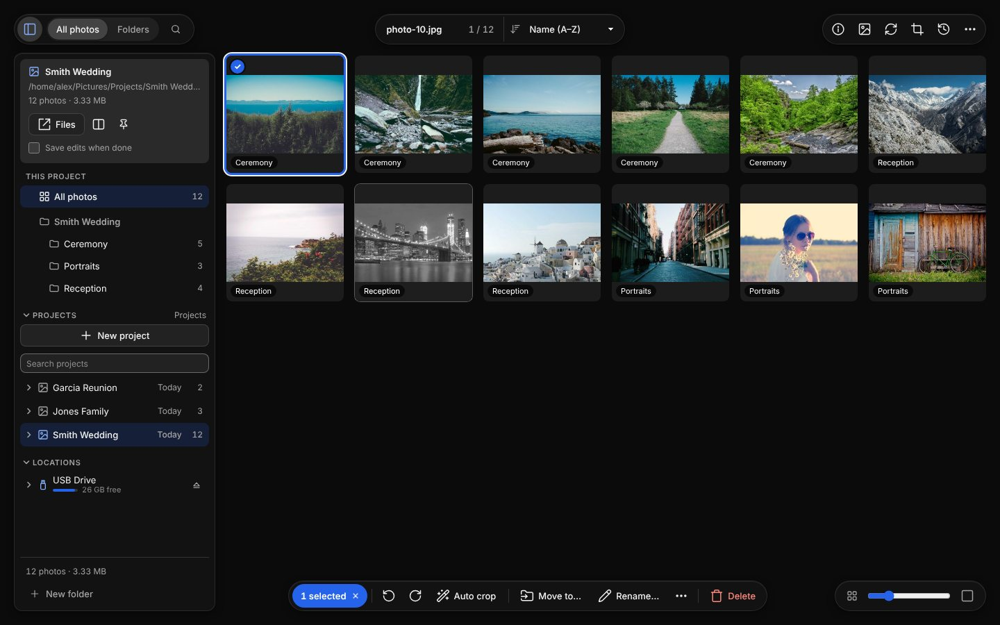

  

<h1 align="center">jEditor</h1>

  <b>Rotate, crop and sort a whole folder of photos, fast.</b> 
  It edits the files right where they are. Nothing to import, nothing uploaded.

  
  
  

  

## Get it

| | |
|---|---|
| **Windows** | [**Download the installer**](https://github.com/xmui/jEditor/releases/latest) `jEditor-Setup-x.y.z.exe`. No admin needed. Or the portable zip. |
| **Mac** | [**Download the .dmg**](https://github.com/xmui/jEditor/releases/latest). Apple silicon and Intel, macOS 12+. Or `brew tap xmui/jeditor https://github.com/xmui/jEditor && brew install --cask jeditor` |
| **Linux** | [**AppImage**](https://github.com/xmui/jEditor/releases/latest) for any distro (updates itself), `.deb` for Ubuntu, Debian and Mint, `.pacman` for Arch |
| **Web** | [**xmui.github.io/jEditor**](https://xmui.github.io/jEditor/) in Chrome or Edge. Nothing to install. |

"Windows protected your PC" or "jEditor can't be opened"?

jEditor isn't code-signed yet, so the first launch needs one extra click:

- **Windows:** click **More info**, then **Run anyway**.
- **Mac:** open **System Settings → Privacy & Security** and click **Open Anyway** next to jEditor.

It only asks once. More in [Installing](docs/installing.md).

## What it does

- **Whole folders, instantly.** Open a folder and every photo is there, in the grid or one by one with a film strip.
- **Rotate, crop, straighten.** Saved straight into the file, with undo. **Auto crop** finds the photo in a scan and crops it for you.
- **Light and color, Lightroom-style** (experimental: Settings → Experimental). Exposure, contrast, highlights and shadows, white balance, levels and curves with a live histogram, a color mixer, color grading, film looks, vignette and grain. Non-destructive: the original is never changed until you export. **Auto color** takes the cast off a faded print.
- **Sort the pile.** Flags, search, rename in bulk, move into folders, find duplicates, delete with undo.
- **Keeps up with you.** It watches the folder, so photos a scanner saves show up on their own.
- **Projects and drives.** A sidebar with your projects, pinned folders and USB drives, and several windows side by side.
- **Yours, on your disk.** No account, no cloud, no catalog to import into.

  

## Every platform

Windows comes first: it gets everything, and each feature is made best there, then brought to the others.

| | Windows | Mac | Linux | Web |
|---|:-:|:-:|:-:|:-:|
| Rotate, crop, flags, rename, move, duplicates, Auto crop | ✓ | ✓ | ✓ | ✓ |
| Adjust (experimental): light, color, levels, curves, color mixer, grading, film looks, masks, sharpening, noise reduction, vignette, grain | ✓ | ✓ | ✓ | ✓ |
| Opens folders with no permission prompts | ✓ | ✓ | ✓ | |
| Sidebar: projects, pinned folders, drives | ✓ | ✓ | ✓ | |
| Several windows and Split | ✓ | ✓ | ✓ | |
| Updates itself | ✓ | ✓ | AppImage | always current |
| Recycle Bin / Trash | ✓ | | | |
| Scanning and camera tethering | ✓ | | | |
| Liquid Glass toolbar (macOS 26) | | ✓ | | |

## Learn more

- [Using jEditor](docs/using-jeditor.md): the keys, the views and every tool
- [Installing](docs/installing.md): where things go, updating, removing
- [Developing](docs/developing.md): how it's built, building it yourself, releasing
- [Roadmap](PLAN.md): what's next, from Lightroom-style editing to a paint tool

Photos in the screenshots: [Unsplash](https://unsplash.com), via [Lorem Picsum](https://picsum.photos).
