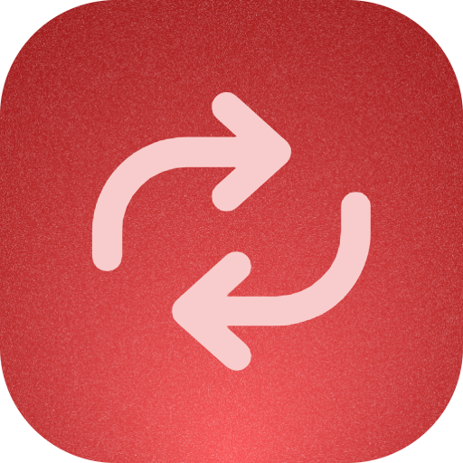
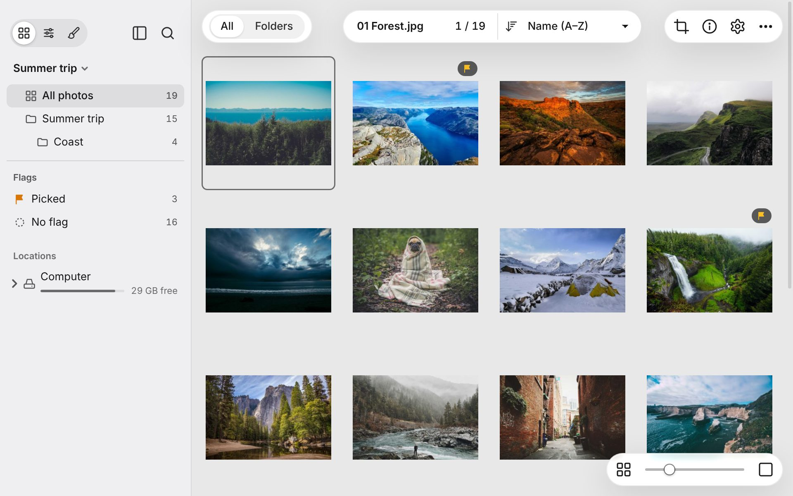
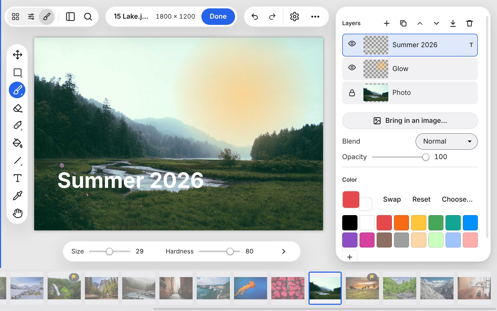
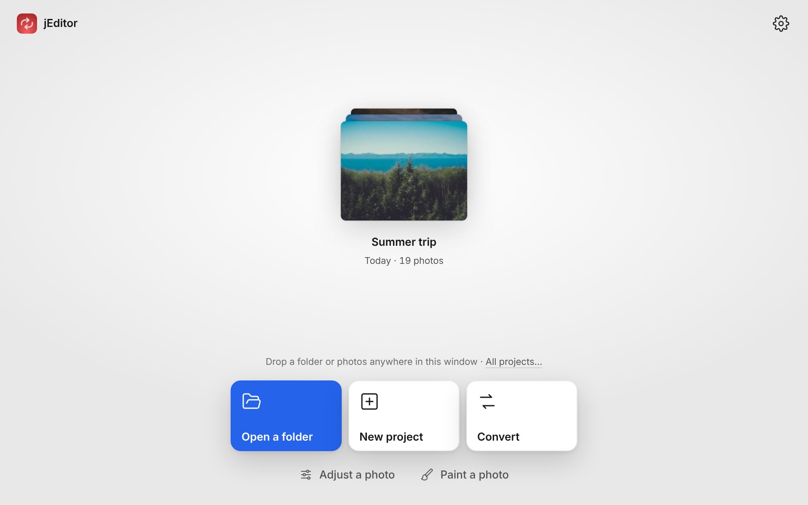

<p align="center">
  
</p>

<h1 align="center">jEditor</h1>

<p align="center">
  <b>A photo viewer, a photo editor and a paint app, in one.</b><br>
  Simple to pick up, and never too much on the screen. It works on your photos right where they are: nothing to import, nothing uploaded.
</p>

<p align="center">
  <a href="https://github.com/xmui/jEditor/releases/latest"></a>
  <a href="https://github.com/xmui/jEditor/actions/workflows/build.yml"></a>
  
</p>

<p align="center">
  <picture>
    <source media="(prefers-color-scheme: dark)" srcset="docs/images/grid-dark.jpg">
    
  </picture>
</p>

## Three apps in one

Switch between them with the buttons at the top left. Each mode shows only what it needs; the rest is in menus.

- **Photos.** Open a folder and every photo is there, in the grid or one at a time with a film strip. Rotate, crop and straighten, flag the keepers, rename, move and delete, all with undo. It's the quick viewer you open a hundred times a day.
- **Adjust.** Light and color, non-destructive: exposure, contrast, highlights and shadows, white balance, levels and curves with a live histogram, a color mixer, color grading, looks, masks for the sky and the subject, and tools that bring old prints back.
- **Paint.** A layers editor over the photo, or on a new canvas: brushes, selections, shapes, text, masks, groups, adjustment layers and filters.

<table>
  <tr>
    <td width="50%">
      <picture>
        <source media="(prefers-color-scheme: dark)" srcset="docs/images/viewer-dark.jpg">
        
      </picture>
      <p align="center"><b>Photos</b>: one at a time, with the film strip</p>
    </td>
    <td width="50%">
      <picture>
        <source media="(prefers-color-scheme: dark)" srcset="docs/images/adjust-dark.jpg">
        
      </picture>
      <p align="center"><b>Adjust</b>: the histogram, looks and every slider</p>
    </td>
  </tr>
  <tr>
    <td width="50%">
      <picture>
        <source media="(prefers-color-scheme: dark)" srcset="docs/images/paint-dark.jpg">
        
      </picture>
      <p align="center"><b>Paint</b>: layers, text that stays editable, the tools down the left</p>
    </td>
    <td width="50%">
      <picture>
        <source media="(prefers-color-scheme: dark)" srcset="docs/images/home-dark.jpg">
        
      </picture>
      <p align="center"><b>Home</b>: back to your last project in one click</p>
    </td>
  </tr>
</table>

## What's new in 2.0

- **A new look.** Glass and pills, and the photo is never under them. One top bar in every mode, a docked sidebar, simpler menus that show their keys, and a light mode.
- **Paint is a layers editor now.** Masks, groups, adjustment layers and filters as layers. Text in your computer's fonts, and text and shapes stay editable. Free transform and Warp (with ready-made styles), Heal and Clone, Symmetry.
- **Adjust goes much further.** Looks you dial in, then keep as your own. Texture, Clarity and Dehaze. Perspective and lens fixes.
- **Bring old prints back.** Restore color finds the fade and takes it off. Drag along a scratch or a crease and it's gone. Descreen takes the dots off a magazine or newspaper scan.
- **Find it, undo it, redo it.** Find anything (`Ctrl+K`) for commands, photos and folders. Redo for every step, even a delete. iPhone photos show in seconds, and on a Mac, your Photos library is in the sidebar.
- **A new start, and safer saving.** A new home page, a short tour and a guide. Edits are kept in jEditor, with a count of what's unsaved, until you write them into the file. A proper Export window.
- **And more.** Culling with flag keys, full screen, a slideshow, glass strength, and smoother scrolling and sharper zoom throughout.

The whole list is under **What's new** in the app, and in [the changelog](app/changelog.js).

## Get it

| | |
|---|---|
| **Windows** | [**Download the installer**](https://github.com/xmui/jEditor/releases/latest) `jEditor-Setup-x.y.z.exe`. No admin needed. Or the portable zip. |
| **Mac** | [**Download the .dmg**](https://github.com/xmui/jEditor/releases/latest). Apple silicon and Intel, macOS 12 or later. Or with Homebrew: `brew tap xmui/jeditor https://github.com/xmui/jEditor && brew install --cask jeditor` |
| **Linux** | [**AppImage**](https://github.com/xmui/jEditor/releases/latest) for any distribution (updates itself), `.deb` for Ubuntu, Debian and Mint, `.pacman` for Arch |
| **Web** | [**xmui.github.io/jEditor**](https://xmui.github.io/jEditor/) in Chrome or Edge. Nothing to install. |

The Mac app also comes in a lighter build on Tauri (`jEditor-x.y.z-mac-tauri.dmg`). For now it's only in the betas: turn on **Settings → Updates → Beta builds**, or take it from a [prerelease](https://github.com/xmui/jEditor/releases).

<details>
<summary>"Windows protected your PC" or "jEditor can't be opened"?</summary>

jEditor isn't code-signed yet, so the first launch needs one extra click:

- **Windows:** click **More info**, then **Run anyway**.
- **Mac:** open **System Settings → Privacy & Security** and click **Open Anyway** next to jEditor.

It only asks once. More in [Installing](docs/installing.md).
</details>

## Quick start

1. **Open a folder** from the home page, or drop a folder or some photos onto the window. Every photo in it shows in the grid.
2. **Look and sort.** Double-click a photo, or press `S`, to see it large; `←` and `→` move between photos, `G` goes back to the grid. `P` flags a keeper, `[` and `]` rotate, `C` crops.
3. **Edit.** `E` opens Adjust on the photo you're on, and `B` opens Paint. **Done** keeps your edits in jEditor; **Write edits to file** (or Export) puts them into a file.
4. **Find anything** with `Ctrl+K` (`⌘K` on a Mac): any command, photo or folder. `Ctrl+Z` undoes any step.

The full guide is in the app (`F1`, or Help → Guide) and in [Using jEditor](docs/using-jeditor.md).

## Every platform

The desktop apps (Windows, Mac and Linux) come first and keep up with each other. The web is a lighter version.

| | Windows | Mac | Linux | Web |
|---|:-:|:-:|:-:|:-:|
| Photos, Adjust and Paint | ✓ | ✓ | ✓ | ✓ |
| Open folders with no permission prompts | ✓ | ✓ | ✓ | |
| Sidebar: projects, pinned folders, drives | ✓ | ✓ | ✓ | |
| Several windows and Split | ✓ | ✓ | ✓ | |
| A menu bar with every command and its key | ✓ | ✓ | ✓ | |
| Paint's Text in your computer's fonts | ✓ | ✓ | ✓ | Chrome, Edge |
| Updates itself | ✓ | ✓ | ✓ | always current |
| Recycle Bin, scanning and camera tethering | ✓ | | | |
| The Photos library in the sidebar | | ✓ | | |
| Open photos and save through the share sheet (iPhone, iPad, Android) | | | | ✓ |

Everything that's only on some platforms, and why: [Platforms](docs/platforms.md).

## Build and test

```sh
npm ci                     # the tests' tools
npm start                  # the web app at http://localhost:3000
npm test                   # the tests, in headless Chrome
```

- **Windows:** `./scripts/build.ps1` builds the app, the portable zip and the installer into `dist\`.
- **Mac and Linux:** `cd mac && npm ci`, then `npm run mac` runs the app from this checkout, and `node mac/build.js` builds the .dmg (on a Mac) or the AppImage, .deb and .pacman (on Linux). `npm run test:mac` runs the desktop app's tests (`xvfb-run -a` without a screen).
- **Screenshots:** `node scripts/readme-shots.js` takes this page's pictures again from the real app.

How it's put together, releases and betas: [Developing](docs/developing.md).

## Learn more

- [Using jEditor](docs/using-jeditor.md): the keys, the views and every tool
- [Installing](docs/installing.md): where things go, updating, removing
- [Developing](docs/developing.md): how it's built, building it yourself, releasing
- [Platforms](docs/platforms.md): what runs where, and how that's decided
- [Roadmap](PLAN.md): what's next

<sub>Photos in the screenshots: [Unsplash](https://unsplash.com), via [Lorem Picsum](https://picsum.photos).</sub>
