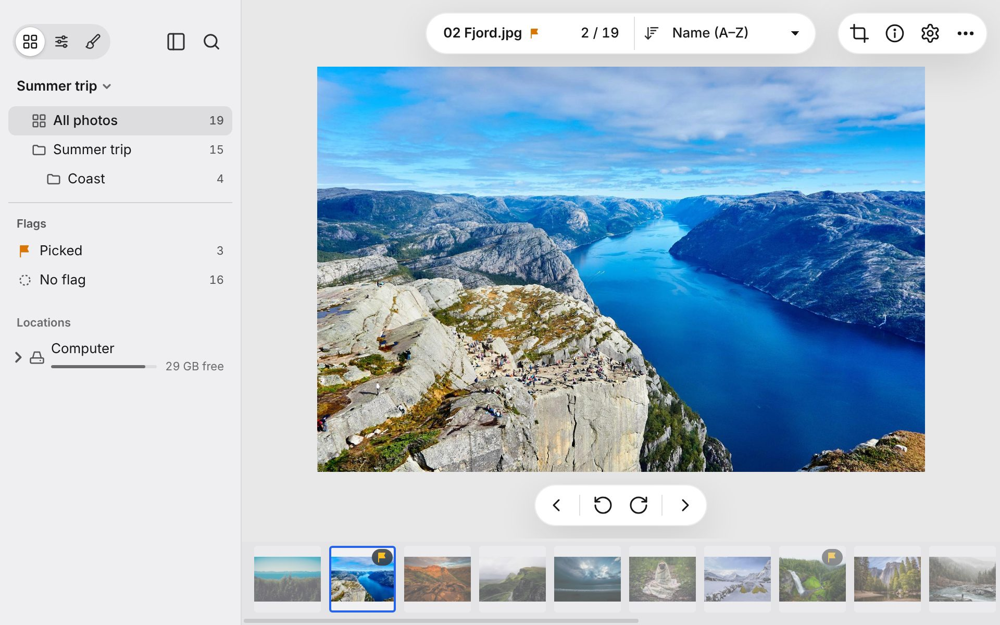

<p align="center">
  
</p>

<h1 align="center">jEditor</h1>

<p align="center">
  <b>One fast app to look at, cull, fix and paint your photos.</b><br>
  Open a folder and get to work. Nothing to import, nothing uploaded, never cluttered.
</p>

<p align="center">
  <a href="https://github.com/xmui/jEditor/releases/latest"></a>
  <a href="https://github.com/xmui/jEditor/actions/workflows/build.yml"></a>
  
</p>

<p align="center">
  <picture>
    <source media="(prefers-color-scheme: dark)" srcset="docs/images/grid-dark.jpg">
    
  </picture>
</p>

<table>
  <tr>
    <td width="33%" valign="top">
      <picture>
        <source media="(prefers-color-scheme: dark)" srcset="docs/images/viewer-dark.jpg">
        
      </picture>
      <p><b>Photos.</b> Look, cull, crop and sort. Every step can be undone.</p>
    </td>
    <td width="33%" valign="top">
      <picture>
        <source media="(prefers-color-scheme: dark)" srcset="docs/images/adjust-dark.jpg">
        
      </picture>
      <p><b>Adjust.</b> Fix light and color. Your original stays safe until you save.</p>
    </td>
    <td width="33%" valign="top">
      <picture>
        <source media="(prefers-color-scheme: dark)" srcset="docs/images/paint-dark.jpg">
        
      </picture>
      <p><b>Paint.</b> Add text, shapes and brushwork on layers you can change later.</p>
    </td>
  </tr>
</table>

## Built for scanning and archives

jEditor grew up working through boxes of scanned prints, so it handles the big, slow jobs well.

- **Scan straight into a folder.** Scan or shoot tethered into the open folder, and each new photo shows up in the grid as it lands. (Scanning and capture are in the Windows app.)
- **Big folders and network drives.** An order of 2,000 photos opens fast, on a network drive too, and once it's been opened it rescans in a moment.
- **Dates and details, in batches.** Give a whole scanned order one date, shift dates when a camera's clock was wrong, or number them in the order they were scanned. Every EXIF, IPTC and XMP field is there when you need it.
- **Bring old photos back.** Restore color takes the fade off a print or slide, a whole roll at once if you like. Find dust and scratches finds them for you, a drag along a crease takes it off, and Descreen removes the dots from a magazine scan.
- **Take less space.** Convert a folder to AVIF, JPEG XL or WebP. If you replace the originals, undo brings them back.
- **Know what's unsaved.** Edits are kept until you're ready. A count shows how many photos have changes, and one click saves or exports them.

## Get it

| | |
|---|---|
| **Windows** | [**Download the installer**](https://github.com/xmui/jEditor/releases/latest) `jEditor-Setup-x.y.z.exe`. No admin needed. Or the portable zip. |
| **Mac** | [**Download the .dmg**](https://github.com/xmui/jEditor/releases/latest). Apple silicon and Intel, macOS 12 or later. Or with Homebrew: `brew tap xmui/jeditor https://github.com/xmui/jEditor && brew install --cask jeditor` |
| **Linux** | [**AppImage**](https://github.com/xmui/jEditor/releases/latest) for any distribution (updates itself), `.deb` for Ubuntu, Debian and Mint, `.pacman` for Arch |
| **Web** | [**xmui.github.io/jEditor**](https://xmui.github.io/jEditor/) in Chrome or Edge. Nothing to install. |

A lighter Mac build on Tauri (`jEditor-x.y.z-mac-tauri.dmg`) is in the [betas](https://github.com/xmui/jEditor/releases) for now.

<details>
<summary>"Windows protected your PC" or "jEditor can't be opened"?</summary>

jEditor isn't code-signed yet, so the first launch needs one extra click:

- **Windows:** click **More info**, then **Run anyway**.
- **Mac:** open **System Settings → Privacy & Security** and click **Open Anyway** next to jEditor.

It only asks once. More in [Installing](docs/installing.md).
</details>

## Quick start

1. **Open a folder**, or drop one onto the window.
2. **Look and sort.** `S` shows one photo, `G` the grid, `←` `→` move between them. `P` flags a keeper, `[` `]` rotate, `C` crops.
3. **Fix and paint.** `E` opens Adjust, `B` opens Paint.
4. **Find anything** with `Ctrl+K` (`⌘K` on a Mac). `Ctrl+Z` undoes any step.

Press `F1` in the app for the guide, or read [Using jEditor](docs/using-jeditor.md).

## Platforms

The Windows, Mac and Linux apps have everything and keep up with each other. The web version is lighter: it has no sidebar of your drives and no extra windows, and scanning is in the Windows app only. The full list is in [Platforms](docs/platforms.md).

## Learn more

- [Using jEditor](docs/using-jeditor.md): every tool and key
- [Installing](docs/installing.md): where things go, updating, removing
- [Platforms](docs/platforms.md): what runs where, and why
- [Roadmap](PLAN.md): what's next

## Build and test

```sh
npm ci && npm test         # the tests, in headless Chrome
npm start                  # the web version at http://localhost:3000
cd mac && npm ci && cd .. && npm run mac   # the Mac and Linux app
```

Windows builds with `./scripts/build.ps1`. [Developing](docs/developing.md) has the rest: building each app, releases and betas. `node scripts/readme-shots.js` takes this page's screenshots again.

<sub>Photos in the screenshots: [Unsplash](https://unsplash.com), via [Lorem Picsum](https://picsum.photos).</sub>
